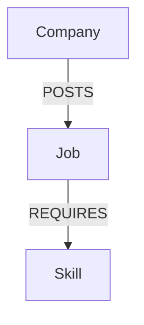

# Job Match Explorer

A graph-powered job matching application built with **CognoDB**.

Users can enter or select their technical skills to discover matching jobs and identify additional skills that can unlock more opportunities.

## Demo

* **Live Demo:** https://job-skill-graph.vercel.app/

---

## Why a Graph Database?

Job matching is primarily about relationships:

```text
Skill → required by → Job → posted by → Company
```

A graph database makes it natural to traverse these relationships.

For example, the application can find jobs matching a user's existing skills and identify additional skills that appear in related job requirements.

This would require multiple joins across tables in a relational database, while graph traversal expresses these relationships directly.

---

## Graph Model



### Nodes

* **Company:** name, industry
* **Job:** title, location, seniority
* **Skill:** name, normalized name, category, aliases

### Relationships

* `Company -[:POSTS]-> Job`
* `Job -[:REQUIRES {mandatory}]-> Skill`

The Skill model supports normalized names and aliases, so inputs such as `React`, `react`, and `reactjs` can refer to the same skill.

---

## Features

* Search/select technical skills
* Find matching jobs
* Rank jobs by skill match
* Show company, location and seniority
* Recommend additional skills to learn
* Loading, empty and error states
* Case-insensitive and alias-aware skill matching

---

## Technology Stack

**Frontend**

* React
* Vite
* CSS

**Backend**

* Node.js
* Express.js
* Neo4j JavaScript Driver

**Database**

* CognoDB
* openCypher
* Bolt

---

## Project Structure

```text
job-skill-graph/
├── backend/
│   ├── server.js
│   ├── seed.js
│   ├── verify.js
│   ├── test-connection.js
│   └── .env
│
├── frontend/
│   └── src/
│       ├── App.jsx
│       └── App.css
│
└── README.md
```

---

## Setup

### 1. Clone

```bash
git clone YOUR_GITHUB_URL
cd job-skill-graph
```

### 2. Backend

```bash
cd backend
npm install
```

Create `.env`:

```env
COGNODB_URI=bolt+s://YOUR_INSTANCE.databases.cognodb.cloud
COGNODB_USER=cognodb
COGNODB_PASSWORD=YOUR_PASSWORD
PORT=4000
```

Seed the database:

```bash
node seed.js
```

Start the backend:

```bash
node server.js
```

### 3. Frontend

```bash
cd frontend
npm install
npm run dev
```


---

## Main Graph Queries

### Job Matching

The application traverses the graph to compare user skills with job requirements and calculate a match score.

```text
User Skills
     ↓
   Skill
     ↓
   Job
     ↓
 Company
```

### Next Skill

The application finds additional skills connected to relevant jobs and counts how many jobs each skill could unlock.

```text
Current Skill
      ↓
      Job
      ↓
Required Skill
```

All database queries use **parameterized Cypher** through the official Neo4j driver.

---

## Seed Data

The included seed script creates:

* **15 Skills**
* **6 Companies**
* **15 Jobs**
* `POSTS` relationships
* `REQUIRES` relationships

Run:

```bash
node verify.js
```

to verify the graph.

---

## Security

Database credentials are stored in environment variables and are excluded from Git using `.gitignore`.


---

## Author

**Shahbaz Ansari**

GitHub: https://github.com/Shahbaz9832

LinkedIn:https://www.linkedin.com/in/shahbaz-ansari-dev/
